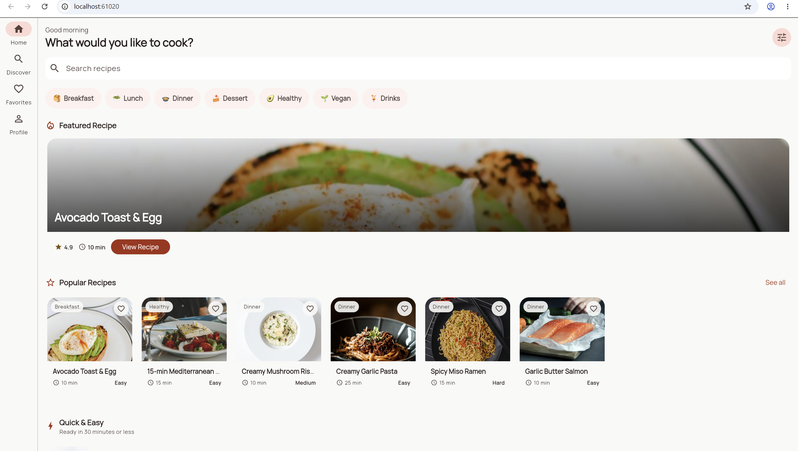
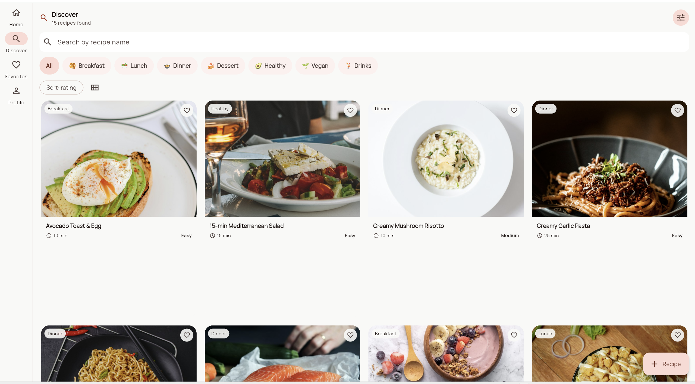
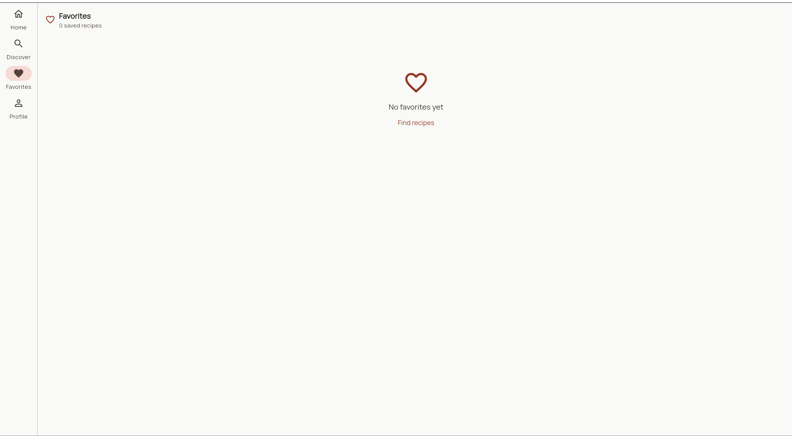
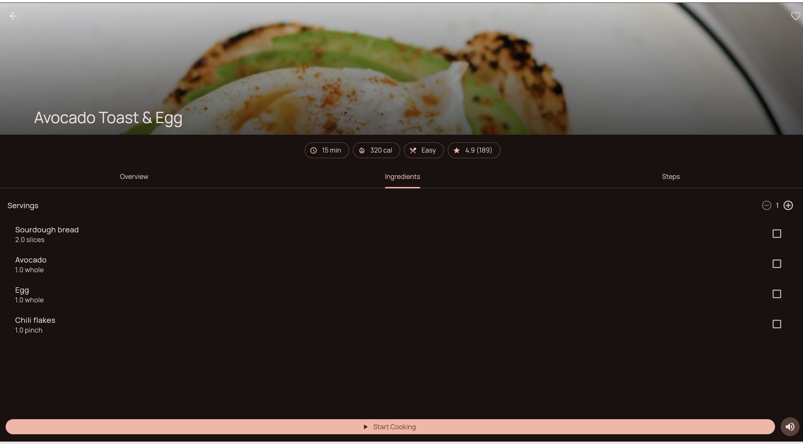
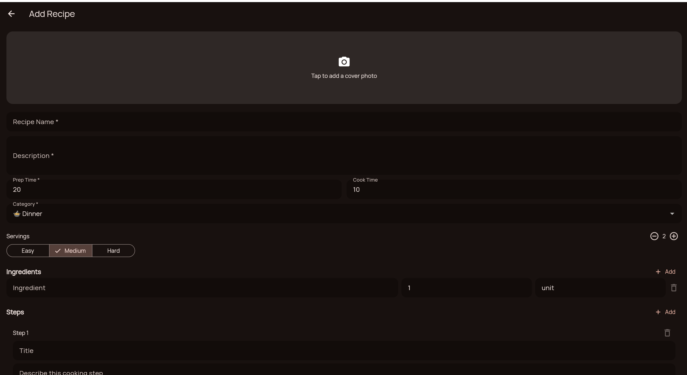
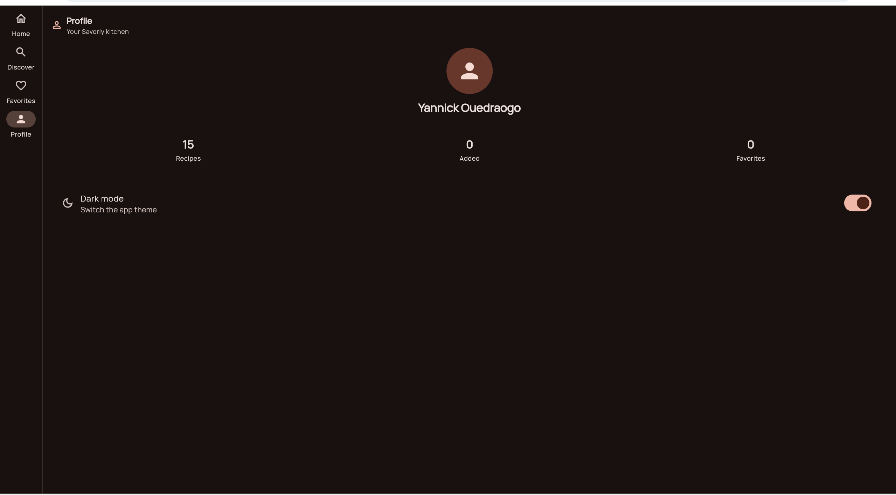

# Savorly

[](https://github.com/LEVI226/FlutterProjectMultiScreenAppWithNavigationNexFlutter/actions/workflows/ci.yml)

A multi-screen Flutter recipe app, originally built for the NextFlutter "Multi-screen app with navigation" certification (99/100), since upgraded to a production-ready standard for the "Tested and optimized production-ready app" certification: a full test suite across unit/widget/integration levels, FR/EN internationalization, accessibility labels, image caching, and CI/CD. See [CHANGELOG.md](CHANGELOG.md) for the version history.

## Features

- Browse featured, popular, and quick recipes on Home.
- Search, filter, sort, and switch grid density on Discover.
- Open recipe details through a `/recipe/:id` route parameter.
- Favorite recipes and review them from Favorites.
- Publish a recipe with a validated form, dynamic ingredients/steps, and a cover photo picker.
- Toggle light/dark mode and switch between English and French from Profile.

## Getting Started

```bash
flutter pub get
flutter run -d chrome
```

You can also run on Windows or an Android device:

```bash
flutter run -d windows
flutter run -d <android-device-id>
```

Recipe photos load from fixed `images.unsplash.com` URLs through `cached_network_image`, which caches them to disk and memory after the first load. If the network is unavailable, the app shows graceful image fallbacks.

## Architecture

```text
lib/
  main.dart     App bootstrap: loads bundled data, wires RecipeStore/ThemeController/LocaleController
  data/         RecipeRepository — loads recipes/categories from bundled JSON, not a network call
  l10n/         ARB translation files (app_en.arb, app_fr.arb) — source for generated AppLocalizations
  models/       Recipe, RecipeIngredient, RecipeStep, Category — plain, immutable data classes
  router/       GoRouter routes and the adaptive (phone/tablet) app shell
  screens/      Home, Discover, Favorites, Profile, Recipe Detail, Add Recipe
  state/        RecipeStore, ThemeController, LocaleController — ChangeNotifier + InheritedNotifier pairs
  theme/        Savorly's light/dark Material themes
  widgets/      Shared recipe/category/section widgets
```

Recipe and category data live in `assets/data/*.json`, not inside widgets — `RecipeRepository` is the only place that reads them, and every screen reads through `RecipeStore` instead.

**State management** uses plain `ChangeNotifier` + a custom `InheritedNotifier` subclass per piece of shared state (`RecipeStoreScope`, `ThemeControllerScope`, `LocaleControllerScope`), rather than a package like Provider or Riverpod. This mirrors the approach already used in the original certified app and keeps the dependency list small — these are both part of the Flutter SDK itself and are sufficient for this app's scale (3 pieces of app-wide shared state, no complex derived-state graph that would benefit from a more elaborate framework). Neither theme nor language choice persists across an app restart by design — both default fresh each launch (theme to `ThemeMode.system`, language to the device's locale).

## Internationalization

Full French and English support via `flutter_localizations`/`intl`. The language defaults to the device's locale on first launch (falling back to English if the device locale isn't French or English) and can be overridden per-session from the Profile screen's language switcher. Every user-facing string across all 6 screens is sourced from `lib/l10n/app_en.arb`/`app_fr.arb`.

## Accessibility

Every icon-only interactive control (the favorite-toggle button, ingredient/step removal buttons, servings steppers) has an explicit semantic label via `tooltip`/`Semantics`, so screen readers announce what each control does rather than just "button."

## NextFlutter Requirements Checklist

| Requirement | Implementation |
| --- | --- |
| At least 5 screens | 6 screens in `lib/screens/` |
| 10+ unit tests | 18 across `test/data/`, `test/models/`, `test/state/` |
| 5+ widget tests | 11 across `test/widgets/`, `test/screens/`, `test/app_navigation_test.dart` |
| 2+ integration tests | `integration_test/favorite_flow_test.dart`, `integration_test/add_recipe_flow_test.dart` |
| Performance: optimized/lazy images | `cached_network_image` caches and fades in every recipe photo; the Home screen's horizontal recipe carousels and the Recipe Detail steps list use `ListView.separated`'s lazy item building. Discover/Favorites' grids use `GridView.builder` nested in a scrollable `ListView` (not independently lazy, since the whole screen scrolls as one unit) — acceptable at this app's data scale (a few dozen recipes), but not claimed as independently lazy |
| Accessibility: semantic labels | See "Accessibility" above |
| Internationalization: FR + EN | See "Internationalization" above |
| CI/CD (GitHub Actions) | `.github/workflows/ci.yml` — `dart format`, `flutter analyze`, `flutter test` on every push/PR to `main` |
| Clean static analysis | `flutter analyze` — 0 issues |
| Professional README | This file |
| CHANGELOG.md, 3+ versions | [CHANGELOG.md](CHANGELOG.md) — `1.0.0`, `1.1.0`, `1.2.0` |

## Testing

```bash
flutter analyze
flutter test
```

The suite is 29 unit/widget tests total: 18 unit tests covering model JSON parsing, repository loading, store derivations/mutations, and theme/locale state, plus 11 widget tests covering reusable cards, screen-level interactions (search/filter/sort on Discover, form validation and publish flow on Add Recipe), and app navigation.

Integration tests exercise the real running app end-to-end and need a connected device/browser — they are **not** part of the CI workflow above (a deliberate scope decision, not an oversight: most CI setups run integration tests in a separate, slower lane, or only locally/on-device, since they need an emulator or browser driver CI would have to provision separately).

On a native device or emulator (Android/iOS/desktop), they run directly:

```bash
flutter test integration_test/ -d <device-id>
```

On web, `flutter test integration_test/` does not support web targets on this Flutter SDK ("Web devices are not supported for integration tests yet.", tied to [flutter/flutter#66264](https://github.com/flutter/flutter/issues/66264)) — `flutter drive` with a chromedriver instance is required instead:

```bash
# Integration tests need a device; on web this requires `flutter drive` + chromedriver
# (plain `flutter test integration_test/` does not support web targets).
# Start a chromedriver binary matching your installed Chrome version, then:
flutter drive \
  --driver=test_driver/integration_test.dart \
  --target=integration_test/favorite_flow_test.dart \
  -d web-server --browser-name=chrome --driver-port=4444

flutter drive \
  --driver=test_driver/integration_test.dart \
  --target=integration_test/add_recipe_flow_test.dart \
  -d web-server --browser-name=chrome --driver-port=4444
```

## APK

Build a debug APK locally with `flutter build apk --debug` (output: `build/app/outputs/flutter-apk/app-debug.apk`). Release APKs can be attached to GitHub Releases.

No iOS/IPA build — this project was developed without access to a Mac/Xcode toolchain.

## Screenshots

<div align="center">
  
  
  
  
  
  
</div>
